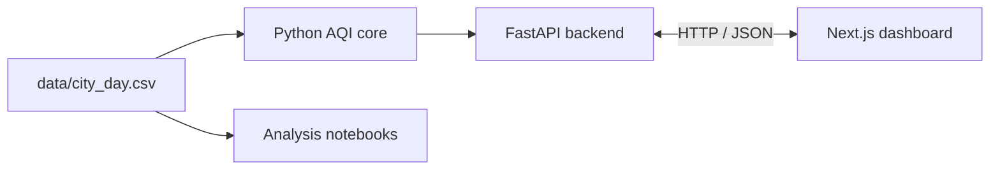

# AQI Explorer

AQI Explorer is a class project for exploring historical air-quality measurements from Indian cities. It combines Python data-analysis exercises with a FastAPI backend and a Next.js dashboard.

The dashboard supports city and date lookup, AQI categories and health guidance, pollutant readings, city summaries and comparisons, and a historical AQI chart. City choices and selectable calendar dates come from the bundled dataset; it does not provide live air-quality readings.

## How it works



The backend reads the CSV when it starts and serves the dashboard through JSON endpoints. The dashboard requests the selected city's daily AQI and pollutant readings, a full-dataset city summary, city comparisons, and history ending on the selected date.

## Features

- Look up a city's recorded AQI by date.
- View the AQI category, health guidance, and available pollutant measurements.
- Review a city's full-dataset average, number of recorded days, and highest AQI day.
- Compare two cities by their average AQI across the dataset.
- Explore up to 120 recent recorded AQI readings through the selected date. Hover over the chart to inspect a reading's date, AQI, and category.
- Browse Jupyter notebooks covering Python data structures, NumPy, Pandas, and data cleaning, with practical exercises for exploring and preparing air-quality data.

## Requirements

- Python and pip
- Node.js and npm

## Run locally

Run the backend from the project root. Create and activate a virtual environment, then install the Python requirements:

**Windows PowerShell**

```powershell
python -m venv .venv
.venv\Scripts\Activate.ps1
python -m pip install -r server/requirements.txt
```

**macOS or Linux**

```bash
python -m venv .venv
source .venv/bin/activate
python -m pip install -r server/requirements.txt
```

Start the API from the project root:

```bash
uvicorn server.app.main:app --reload
```

The API runs at `http://127.0.0.1:8000`. Interactive API documentation is available at `http://127.0.0.1:8000/docs`.

In a second terminal, start the dashboard:

```bash
cd client
npm install
npm run dev
```

Open `http://localhost:3000`. To connect the frontend to the local API on port 8000, copy `client/.env.example` to `client/.env.local`; change `NEXT_PUBLIC_API_BASE_URL` there if your API uses another URL.

If PowerShell blocks the `npm.ps1` script, use `npm.cmd` in its place (for example, `npm.cmd install` and `npm.cmd run dev`).

## Deploy on Vercel

The root `vercel.json` configures two services in one Vercel project: the Next.js dashboard in `client/` and the FastAPI backend in `server/`. The backend service uses the repository root so its runtime can access the shared `src/` package and `data/` dataset, with `server/app/main.py` as its entrypoint. Requests under `/api/` are routed to the backend; all other requests are routed to the dashboard. In production, the browser calls `/api/...` on the same domain, so no API URL environment variable is needed. `NEXT_PUBLIC_API_BASE_URL` remains available for local development when the frontend and backend run on different ports.

## API endpoints

| Endpoint | Purpose |
| --- | --- |
| `GET /api/health` | Check that the API is running. |
| `GET /api/cities` | List cities with available AQI data. |
| `GET /api/dates?city=Delhi` | List recorded dates for a city. |
| `GET /api/aqi?city=Delhi&date=2019-05-01` | Get a city's AQI, category, advice, and pollutant readings for a date. |
| `GET /api/summary?city=Delhi` | Get full-dataset city statistics. |
| `GET /api/history?city=Delhi&limit=120&through=2019-05-01` | Get recent AQI readings on or before an optional date. |
| `GET /api/compare?cities=Delhi&cities=Mumbai` | Compare two to six cities by full-dataset average AQI. |

City names are case-insensitive. Dates use `YYYY-MM-DD`. The history limit can be set from 12 to 1000 records; the dashboard requests 120.

## Checks

From the project root, run the backend tests:

```bash
python -m pytest -q
```

Check frontend types and create a production build from `client/`:

```bash
npm run typecheck
npm run build
```

On Windows PowerShell, use `npm.cmd run typecheck` and `npm.cmd run build` if PowerShell blocks `npm.ps1`.

## Dataset and interpretation

The bundled `data/city_day.csv` contains historical daily AQI and pollutant measurements, including PM2.5, PM10, NO2, CO, SO2, and O3. The API excludes rows without a known AQI value. The exact upstream source and license are not documented in the repository; confirm them before redistributing the dataset.

The daily reading and pollutant panel use the selected city and date. The city summary and city comparison use all available records for each city, so those averages do not change when the selected date changes. History is limited to records on or before the selected date.

AQI categories follow the ranges used by this project:

| AQI | Category |
| ---: | --- |
| 0-50 | Good |
| 51-100 | Satisfactory |
| 101-200 | Moderate |
| 201-300 | Poor |
| 301-400 | Very Poor |
| Above 400 | Severe |

## Project structure

```text
aqi-explorer/
|-- data/
|   `-- city_day.csv
|-- notebooks/
|   |-- part1_core.ipynb
|   |-- part2_structures.ipynb
|   |-- part3_numpy_cleaning.ipynb
|   `-- part4_pandas.ipynb
|-- reports/
|   `-- Report.pdf
|-- server/
|   |-- app/
|   |   `-- main.py
|   |-- tests/
|   |   `-- test_api.py
|   `-- requirements.txt
|-- client/
|   |-- app/
|   |   |-- page.tsx
|   |   `-- globals.css
|   |-- public/
|   |-- package.json
|   `-- .env.example
`-- src/
    `-- aqi_core/
        |-- categories.py
        `-- dataset.py
```

---
